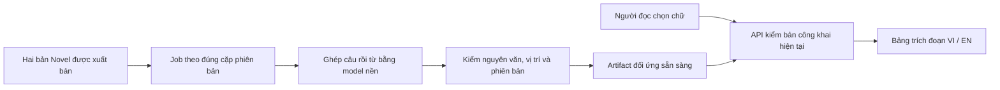

# Đề xuất: tra từ/cụm từ và đối chiếu câu từ hai bản Novel VI–EN

Ngày khảo sát: 12/11/2026. Trạng thái: **người dùng đã duyệt triển khai ngày12/11/2026**. Thực hiện local và đo POC trước khi chốt model/runner production. `tasks/plan.md` được giữ nguyên; các hợp đồng module nằm trong SPEC-text-anchors.md, SPEC-auto-alignment.md, SPEC-alignment-publishing.md và SPEC-lookup-ui.md.

## 1. Phạm vi người dùng đã chọn

- Thay thao tác mở Google Translate bằng tra ngay trong hai bản Novel VI/EN đã có.
- Hỗ trợ một từ, cụm từ, câu hoặc đoạn ngắn, cả VI→EN và EN→VI.
- **Tự động hoàn toàn**, được phép báo chưa chắc chắn; không có bước editor phải ghép hoặc duyệt từng cặp.
- Kết quả và câu ngữ cảnh đều trích đúng chữ có sẵn trong bản đối ứng. Model chỉ tìm vị trí liên hệ giữa hai bản.
- Dùng trong Ebook/Sách trên PC và điện thoại, giữ vị trí đọc khi mở/đóng công cụ.
- Phạm vi Novel văn bản. TT và PDF nguyên trang không nằm trong lần này. Lời tựa VI chưa có EN phải báo thiếu bản đối ứng.

## 2. Bằng chứng từ mã và dữ liệu hiện tại

- `src/components/Reader.tsx`: menu chọn chữ đang dùng một thẻ `a` gọi `translationUrl(selection.text, locale)`; selection đã có `start/end/text`.
- `src/lib/content.ts`: `translationUrl()` tạo URL Google; `resolveAnchor()` đã có nguyên tắc kiểm revision và nguyên văn trước khi dùng vị trí.
- `src/components/ParallelReader.tsx`: có sẵn đọc hai cột VI/EN, cuộn độc lập; hiện chưa ghép câu/từ. Có thể tái sử dụng để mở ngữ cảnh đối chiếu.
- `src/lib/server.ts`: HTML bản còn lại được bỏ khỏi payload Reader; `/api/book` hiện trả cả sách. Không dùng việc tải lại cả sách cho mỗi lần tra.
- API công khai tại thời điểm khảo sát có **20 chương VI, 20 EN**, lời tựa chỉ VI; JSON toàn sách khoảng **892.627 byte**.
- Chỉ **4/20** chương có cùng số khối kể chuyện được nhận diện. Ví dụ chương 2: VI 165 / EN 50; chương 18: VI 250 / EN 28. Đây là khối HTML trước nhãn lời bình/chú thích, không phải số câu hay chất lượng dịch. **Ghép theo thứ tự đoạn hoặc tỷ lệ cuộn sẽ sai.**
- Ghép bằng `chapterId` ổn định; thứ tự mảng/mục lục chỉ dùng để hiển thị.
- `node-html-parser.textContent` thêm newline cho `br`, trong khi DOM `textContent` của Reader không thêm ký tự đó. Chuỗi dùng cho ML phải có bản đồ vị trí về đúng văn bản Reader.
- Báo cáo khảo sát chỉ đọc: `D:/codex/2026-10-22/p/work/novel-lookup-planning/public-structure.json`. Không sửa văn bản/chính tả, bản nháp hoặc file nguồn.

## 3. Cách người đọc sử dụng

1. Bôi đen → bấm **Tra VI↔EN** trong menu hiện tại.
2. Công cụ chụp selection cùng chapter/locale/revision; mở bảng ở cạnh nội dung trên PC, bảng dưới trên điện thoại. Bảng nằm ngoài root văn bản và không làm đổi chiều cao vùng đọc.
3. Hiển thị đoạn đã chọn, từ/cụm đối ứng được gợi ý, và câu ngữ cảnh từ hai bản với phần liên quan được tô rõ.
4. Mặc định ghi **Gợi ý đối ứng trong sách**. Khi phân vân, ghi **Chưa chắc chắn** và cho xem ngữ cảnh/ứng viên thay thế. Không biến điểm cosine thành phần trăm độ chính xác.
5. Không có từ đối ứng trực tiếp: báo rõ và đưa câu/nhóm câu tương ứng. Ví dụ một từ được lược bỏ hoặc dịch thoát nghĩa sẽ không bị gán bừa cho từ gần nhất.
6. **Mở đối chiếu** dùng `ParallelReader`, đưa hai cột đến đúng vùng đã ghép. Đóng bảng trở về đúng vị trí đọc; menu VI/EN vẫn giữ hành vi tiến độ riêng từng ngôn ngữ hiện có.

Các trạng thái phải phân biệt: thiếu bản dịch; đang chuẩn bị dữ liệu đối ứng; không có phần tương ứng; gợi ý chưa chắc; lỗi mạng có Thử lại. Không tự mở dịch vụ bên ngoài khi không có kết quả.

UI giữ giấy ngà/mực trầm hoặc theme đang dùng. Có focus rõ, Escape/Đóng, vùng chạm44px, safe-area và hỗ trợ bàn phím/voice-over. Mở bảng tạm dừng tự cuộn/lật chờ; giữ snapshot selection khi focus rời nội dung. Không chèn span hoặc nút vào chuỗi gốc làm lệch ghi chú/TTS.

## 4. Bản đồ khả năng đề xuất

| Module id | Trách nhiệm | Phụ thuộc |
|---|---|---|
| `text-anchors` | Trích văn bản/ranh giới, bản đồ vị trí, kiểm nguyên văn và phiên bản | — |
| `auto-alignment` | Tự ghép câu/nhóm câu rồi từ/cụm, đánh giá độ chắc và trường hợp không tương ứng | `text-anchors` |
| `alignment-publishing` | Job nền tự động, artifact theo phiên bản, quyền truy cập và API tra | `auto-alignment` |
| `lookup-ui` | Menu chọn chữ, bảng kết quả hai chiều, mở đối chiếu đúng chỗ | `text-anchors`, `alignment-publishing` |

Thứ tự xây: anchors → thử nghiệm alignment trên hai chương → lifecycle/API → Reader/UI → xử lý cập nhật và offline → kiểm thử local → production. UI có thể thử sớm bằng fixture, độc lập với việc chọn model; không công bố fixture thành kết quả thật.

## 5. Cách ghép tự động

### 5.1. Chuỗi và vị trí

- Giữ một chuỗi chính xác tương ứng DOM `contentRef.textContent`, một chuỗi phục vụ phân tích có dấu phân cách khối hợp lý, và bảng chuyển đổi giữa chúng.
- Dùng cùng HTML đã làm sạch/chuẩn hóa như Reader. Dùng UTF-16 cho API/UI; đổi rõ chỉ số từ tokenizer/Python về UTF-16, kiểm emoji, dấu ghép Unicode và ký hiệu chú thích.
- Xác định riêng truyện, lời bình và chú thích; không để một câu truyện bị ghép vào mục Notes vì trùng tên riêng.
- Ranh giới câu có thể bắt đầu bằng `Intl.Segmenter` trên Node hiện có, sau đó xử lý thơ, câu thoại và các khối bị xuống dòng giữa câu. Không coi mỗi dấu cách là một từ tiếng Việt hoàn chỉnh.
- Mỗi vùng giữ start/end, nguyên văn, ngữ cảnh trước/sau và hash chuỗi. Mọi kết quả phải qua kiểm `text.slice(start,end) === quote`.
- Normalization phục vụ tìm kiếm không thay chuỗi gốc, dấu tiếng Việt, chú thích hay offset ghi chú hiện có.

### 5.2. Ghép câu trước

- Dùng embedding đa ngôn ngữ để so sánh nghĩa, kết hợp thứ tự tương đối, tiêu đề phần, dấu câu và tên riêng.
- Ghép 1↔1, 1↔n, n↔1, có thể bỏ qua phần không có đối ứng. Cho phép nhóm qua nhiều khối HTML khi bản VI xuống dòng vụn. Không ép đủ số cặp.
- Thứ tự giúp thu hẹp ứng viên nhưng phải có đường xử lý đoạn đảo thứ tự, thơ hoặc bản dịch gộp/tách câu.
- Ứng viên thử đầu: `intfloat/multilingual-e5-small`. Model card có giới hạn512 token; đoạn dài phải chia có overlap và ánh xạ lại, không cắt thầm phần cuối. Đây là ứng viên, chưa phải model được chốt hoặc kết quả đã đo.

### 5.3. Ghép từ/cụm trong ngữ cảnh đã ghép

- Thử phương pháp contextual word alignment của AWESOME-align/mBERT, hoặc adapter tương đương trên Transformers được kiểm chứng. Không cài mù bộ dependency cũ của repo vào ứng dụng Next.js.
- Giữ quan hệ nhiều-nhiều giữa token/nhóm token và bản đồ về vị trí gốc. Một cụm VI có thể tương ứng một từ EN, hoặc ngược lại.
- Tra theo đúng occurrence và câu chứa selection; cùng một từ xuất hiện hai chỗ không dùng chung một đáp án cố định.
- Chỉ lấy từ/cụm từ các câu đích đã ghép. Nếu từ đích rời nhau, tô các vùng trong nguyên câu, không nối thành một câu mới rồi coi đó là trích dẫn.
- Dùng cả độ chắc của bước ghép câu và ghép từ, khoảng cách giữa các ứng viên, độ phủ selection và kiểm tra hai chiều để phân loại gợi ý.
- Bảng benchmark của repo AWESOME-align không chứng minh độ đúng cho văn học cổ VI–EN này. Phải đo trên sách thật trước khi chọn ngưỡng/model.

## 6. Xử lý nặng chạy nền, tra cứu nhẹ

- Tiền xử lý một lần cho từng cặp phiên bản. Người đọc không tải model ML và không khởi động model mỗi lần bấm.
- POC chạy trong runtime/venv tách biệt ở `work/`, giữ model cache ngoài repo; không sửa Python hệ thống.
- Production cần một runner nền được kích hoạt tự động, độc lập với trình duyệt editor. Sau POC mới chốt dùng runner hiện có, workflow/worker định kỳ hoặc worker luôn hoạt động dựa trên RAM, thời gian và tần suất xuất bản đã đo.
- Script phải chạy tay trên PC chỉ là công cụ thử, chưa đạt tiêu chí tự động production. Nếu runner ngừng, job phải tồn tại và được xử lý lại; Novel vẫn xuất bản/đọc bình thường.
- Model mở là phương án thử ưu tiên. Chưa chọn API AI trả phí, fine-tune hay dịch vụ hosting mới; nếu cần sẽ trình phương án tài nguyên/chi phí trước khi cấu hình.

## 7. Dữ liệu và xuất bản

Đề xuất tối thiểu **hai nhóm metadata**: `alignment_jobs` và `alignment_runs`; bản đồ câu/từ và text snapshot nằm trong artifact JSON theo cặp phiên bản ở Storage riêng. Không tạo một dòng database cho mọi token và không sao chép lại HTML vào hàng nghìn bản ghi.

Khóa định danh gồm chapterId, VI versionId, EN versionId, codecVersion, algorithm/model revision. Anchor mỗi phía lưu start/end UTF-16 + quote/hash. Kết quả API có `match`, `uncertain`, `context-only` hoặc trạng thái không có kết quả rõ nghĩa; điểm thô chỉ dùng nội bộ.

- Enqueue tự động sau thay đổi bản đã xuất bản, có khóa duy nhất chống job trùng và lease/retry giới hạn. Bản nháp không tạo dữ liệu công khai.
- Worker chỉ đọc đúng snapshot đầu vào. Trước khi đặt run thành ready phải kiểm lại cặp phiên bản; job đã lỗi thời không thay artifact đang phục vụ.
- API tra xác minh source revision/quote và **cả hai published versionId** đang hoạt động. Không nhận UUID bất kỳ từ khách rồi đọc bản nháp/lịch sử.
- RLS và server kiểm quyền. Chỉ thành viên đang có quyền được tạo lại job từ admin; runner dùng thông tin xác thực phía server với phạm vi nhỏ nhất có thể. Khách chỉ nhận dữ liệu của hai bản đang công khai.
- Thu hồi/chỉnh sửa một phía làm dữ liệu cặp cũ không còn dùng cho lượt tra mới. Job lỗi không phá bản Novel hoặc artifact của các cặp phiên bản khác.
- Editor chỉ thấy trạng thái, lần cập nhật và Thử lại/Tạo lại khi cần; không phải duyệt từng từ/câu.
- API chỉ trả trích đoạn cần thiết. Cache theo cặp phiên bản + codec + model; hủy request cũ khi người đọc đổi chương/ngôn ngữ hoặc chọn đoạn khác.
- Gói offline về sau chứa artifact tương ứng đúng hai bản đã tải. Không trộn artifact mới với text cũ; thiếu artifact phải báo rõ. Không gọi AI hoặc Google khi đang offline.

## 8. Các lát triển khai và điểm kiểm chứng

| Bước | Kết quả có thể xem/kiểm tra | Điều kiện đi tiếp |
|---|---|---|
| 1. Anchors | Fixture HTML thực tế, codec/string map và kiểm quote | Mọi span ánh xạ ngược chính xác; không đổi text/ghi chú |
| 2. POC tự động | Chạy chương 1 và18, bảng kết quả hai chiều kèm độ chắc | Đo riêng độ đúng, độ phủ, fallback, RAM/thời gian; có ví dụ sai |
| 3. Dữ liệu nền | Job/run/artifact/RLS và API cho một cặp phiên bản | Không lộ nháp, xử lý lại được, loại job lỗi thời |
| 4. Reader local | Nút tra, bảng PC/mobile và mở hai cột đúng vùng | Không nhảy vị trí, kết quả cũ không đè selection mới |
| 5. Tự cập nhật | Xuất bản/thu hồi, editor status, cache/offline | Đóng trình duyệt editor vẫn hoàn tất tự động, mismatch bị chặn |
| 6. Toàn sách | Tạo artifact cho20 cặp, kiểm trường hợp khó | Báo cáo chất lượng và lỗi rõ; lời tựa thiếu EN hiển thị đúng |
| 7. Phát hành | Unit/integration/E2E, build, source review, kiểm URL thật | Duyệt bản local, kiểm quyền và luồng thật trước khi báo hoàn thành |

Mỗi bước là một nhiệm vụ có test/fixture riêng; chia tiếp khi thay quá khoảng5 file. Không cài model, migration hoặc deploy trong lượt lập kế hoạch này.

## 9. Ngân sách chất lượng và độ mượt đề xuất

- Tập đánh giá local ban đầu khoảng120 selection giữ lại, cân bằng VI→EN/EN→VI, từ/cụm/câu, tên riêng, thơ, từ lặp, dịch thoát nghĩa và trường hợp không có đối ứng. Đánh giá QA không biến thành công việc editor bắt buộc khi sử dụng.
- Mục tiêu POC để thảo luận: đối chiếu câu đúng ngữ cảnh ≥90%; gợi ý từ/cụm ≥85% trên tập giữ lại. Đồng thời báo **tỷ lệ phủ và tỷ lệ không tìm thấy**, không chỉ chọn vài ví dụ đẹp. Đây là mục tiêu nghiệm thu, chưa phải kết quả đo hay cam kết model đạt.
- Độ chắc là nhãn đã hiệu chỉnh bằng tập đánh giá, không phải xác suất suy ra trực tiếp từ cosine. Trường hợp thiếu đối ứng phải có thể từ chối/fallback.
- Bảng phản hồi ngay khi bấm; mục tiêu dữ liệu đã cache hiển thị dưới100ms. Đặt ngân sách cold lookup dự kiến p95≤1,5s trong điều kiện đo đã nêu; đo lại trên thiết bị/mạng đại diện trước khi chốt.
- Payload excerpt mục tiêu≤64KB; không gửi cả sách cho một lượt tra, không có request/model chạy khi reader idle. Request chậm có timeout/Thử lại và không khóa lật trang.
- Chọn đoạn dài phải có giới hạn rõ, không cắt thầm. Đề xuất ban đầu tối đa2.000 ký tự UTF-16 và5 câu; chốt sau POC/UX.

## 10. Vị trí mã dự kiến và kiểm thử

- `src/lib/`: codec anchors và logic resolve/rank kết quả nhỏ dùng chung; thêm unit test trong `tests/`.
- `scripts/align-novel/`: pipeline nền và manifest dependency/model đã pin; runtime/cache trong `work/` được bỏ khỏi Git.
- `supabase/migrations/`: schema/RLS/RPC job và chỉ mục tối thiểu, sau khi chốt hợp đồng.
- `app/api/`: public lookup có kiểm current pair; `app/api/admin/`: status/retry theo quyền hiện có.
- `src/components/Reader.tsx`: thay nút Google; bảng lookup lazy-load; `ParallelReader.tsx`: nhận vị trí đối chiếu đã kiểm.
- `src/lib/offline-book.ts`, `offline-client.ts`: bổ sung artifact có version/schema và giữ đọc bản cũ an toàn.
- `src/lib/content.ts`, `tests/content.test.ts`: bỏ helper/test URL Google khi chuyển sang luồng mới; tìm mọi caller trước khi xóa.
- Vitest/integration: split/merge/reorder/omission, đa nghĩa, nhiều occurrence, từ nhiều âm tiết, Unicode/emoji/entities/br, span rời nhau, draft/RLS, job retry/race/withdraw, publish khi một phía thiếu, stale artifact.
- Playwright: VI/EN, PC/Android/WebKit, Ebook/Sách, selection cảm ứng, popup không làm lật trang, kết quả đến muộn, đổi chương/locale khi chờ, đóng/mở giữ đúng dòng/cuộn, đối chiếu đúng vùng, mất mạng và thiếu bản dịch.
- Kiểm mạng khẳng định thao tác không mở Google và không gửi selection đến dịch vụ ngoài. Build/bundle không chứa model weights, credential hoặc dependency ML.

Lệnh nền của repo: `npx vitest run --maxWorkers=2`, `npm run typecheck`, `npm run build`; E2E dùng `BASE_URL=http://localhost:3003` rồi `npx playwright test e2e/novel-lookup.spec.ts --project=desktop`, và cấu hình reader cho `android-phone`/`webkit-phone` sau khi thêm suite. Script/model POC sẽ có lệnh riêng sau khi pin runtime, không trình bày lệnh chưa tồn tại như thể đã chạy.

## 11. Nguồn và các quyết định cần chốt sau POC

- [AWESOME-align, repo tác giả](https://github.com/neulab/awesome-align): word alignment từ mBERT, input câu song song đã token hóa, cặp token và score; chất lượng phụ thuộc cấu hình. Cần kiểm riêng license mã và weights, pin revision và thử compatibility trước khi tái sử dụng.
- [Model card multilingual-e5-small](https://huggingface.co/intfloat/multilingual-e5-small): embedding đa ngôn ngữ384 chiều, prefix cho tác vụ đối xứng, giới hạn512 token và lưu ý không suy xác suất từ trị số cosine.
- [Hugging Face tokenizer API](https://huggingface.co/docs/transformers/main_classes/tokenizer): mapping token/ký tự của fast tokenizer; đã truy vấn qua Context7. Chưa chọn phiên bản package để cài.
- [Intl.Segmenter](https://developer.mozilla.org/en-US/docs/Web/JavaScript/Reference/Global_Objects/Intl/Segmenter): segmentation theo locale. Runtime Node tại repo nhận `vi/en`; ví dụ đơn giản không chứng minh đã xử lý đúng thơ/văn cổ.
- [Supabase changelog](https://supabase.com/changelog): đã kiểm chỉ mục hiện tại; các thay đổi CLI/migration cần kiểm lại trước khi triển khai schema. Lượt này không chạy migration hay nâng SDK.

**Cần chốt bằng POC:** model và mức chất lượng thực tế; nơi chạy runner tự động; tài nguyên/chi phí; ngưỡng từ/cụm và giới hạn selection. Không áp đặt duyệt thủ công, tự viết thêm bản dịch, tự sửa tiếng Việt, hoặc hứa mọi từ đều có một từ tương ứng.
